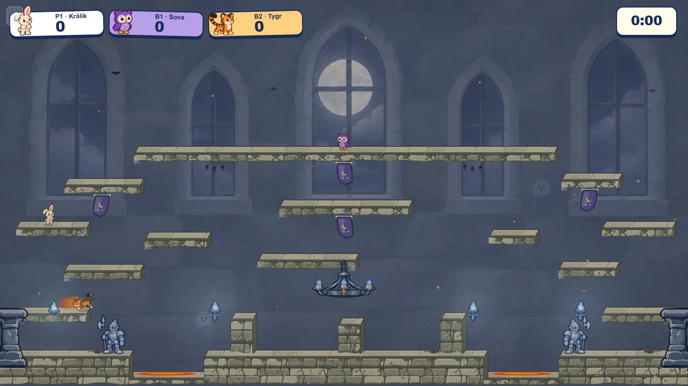
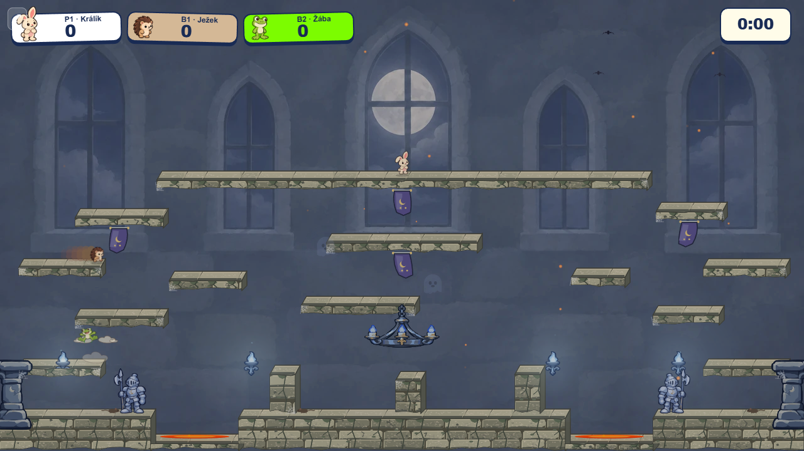
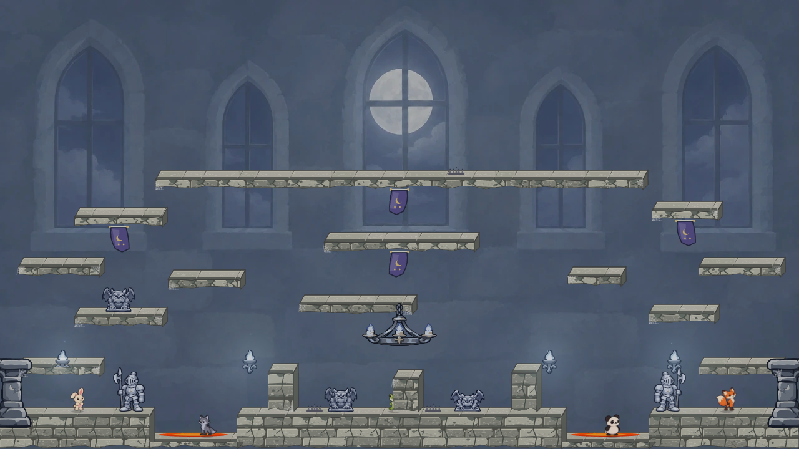
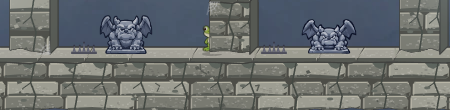

# Castle cartoon props

The latest [royal gallery pass](royal-gallery/README.md) removes the misleading freestanding columns and adds cartoon royal portraits, upper-platform cloth and relief, and restrained wall wear. The rejected gargoyle keystones were removed. Windows are unchanged. See its matched full-scene before/after captures.

The earlier [Castle layout pass](layout/README.md) moved the guards onto the long upper platform, relocated the clipped columns to open floor bays, distributed four sconces across clear wall bays, and lowered the chandelier. The later royal gallery pass removes those columns after they were found to imply false collision.

The approved quieter Balanced Silver from the [Castle atmosphere gallery](atmosphere/README.md) is implemented in the playable arena. The [thorn silhouette gallery](thorns/README.md) remains an unselected study; production thorns are unchanged.

The approved Moonlit props use simplified storybook silhouettes and broad light/shadow planes. The guard, sconce, chandelier, and now-retired edge column were traced to editable [SVG masters](svg/) and rendered as transparent WebP files for the game. A browser probe found that `createImageBitmap` could not decode the SVG Blob in Edge, while the WebP files loaded in both canvas-owning worker modes. Run `node docs/mockups/castle-cartoon-props/rasterize.mjs` with `CASTLE_PROPS_BROWSER` set to a local Chromium or Edge binary to regenerate the traced runtime files.

The original four traced WebP files total 40,972 bytes, including the retained column master. The small sconce is inlined by Vite. The guard, sconce and chandelier must decode before the illustrated prop set renders; a missing core image uses the Canvas fallback. The two new portraits load with Castle and render when available. Guards, sconces and portraits sit behind players; the chandelier is foreground. The five warm wall torches are replaced by four cool sconces, and sparse Moonlit banners retain their reactive sway. Gameplay geometry and hazard collision are unchanged.

| Default simulation worker | `simWorker=off` |
| --- | --- |
|  |  |

Both captures are from the production preview after countdown. Focused tests, the production build, and direct-entry and Meadow-to-Castle switching in both worker modes passed. The deterministic initial-bundle budget passed at 158,350 / 163,840 gzip bytes. The optional constrained-browser loading probe could not launch because the bundled Playwright Chromium is absent on this machine; live captures used installed Edge.

## Selected Guardian — vector trace study

Guardian was selected from the rendered Bulldog variations below. Its painted source was alpha-cropped and reduced to a 200 × 156 preparation image before spline tracing; this keeps the chosen silhouette and major value planes while limiting small source texture. The **10-color trace** is the preferred master: its chipped horn, raised wings, heavy brows, tusks and paws remain visible at the 39 px display height, and the 16-color version adds little legibility. The resting master has 221 paths / 44,784 bytes; its separately drawn and traced compressed pose has 188 paths / 35,264 bytes. Both SVGs are editable and transparent.

| Version | Editable source | Full Castle scene | 1:1 action-lane crop |
| --- | --- | --- | --- |
| Painted reference | [PNG](bulldog-renders/guardian.png) | [Open](bulldog-renders/rendered-guardian.png) | [Open](bulldog-renders/detail-rendered-guardian.png) |
| 10-color rest + authored compression | [Rest SVG](bulldog-renders/guardian-trace-10.svg) · [Compressed SVG](bulldog-renders/guardian-compressed-trace-10.svg) | [Open](bulldog-renders/traced-guardian-10.png) | [Open](bulldog-renders/detail-traced-guardian-10.png) |
| 16-color comparison | [SVG](bulldog-renders/guardian-trace-16.svg) | [Open](bulldog-renders/traced-guardian-16.png) | [Open](bulldog-renders/detail-traced-guardian-16.png) |

The [trace script](bulldog-renders/traceGuardian.mjs) retains the crop, preparation size, and VTracer settings; it needs Playwright, installed Edge/Chromium, and `@visioncortex/vtracer` (`VTRACER_MODULE` can point to a local install). The [compressed painted source](bulldog-renders/guardian-compressed.png) was drawn as a lower crouch with paws planted and wings opened, then traced separately.

The selected 10-color masters now drive Castle's spring. [Rasterize the two SVGs](bulldog-renders/rasterizeGuardian.mjs) to regenerate the transparent runtime WebPs: [rest](../../../src/engine/arenas/assets/castle-guardian-rest.webp) and [compressed](../../../src/engine/arenas/assets/castle-guardian-compressed.webp). The arena preloads both in the renderer's realm; if either decode fails, the complete old Canvas gargoyle remains available. The compressed drawing is selected by the raw spring contact cooldown for roughly the first 0.14 seconds after impact, then returns to rest. Its base remains planted while the spring collision square, bounce physics, and object placement stay unchanged. The full scene and 1:1 crop below show the production renderer with a resting and compressed Guardian.

The two WebPs total 23,922 bytes. The production build and 15 focused tests pass. Direct Castle entry and Meadow-to-Castle switching loaded both Guardian images and rendered without page errors in the default simulation worker and `simWorker=off` modes. Those browser checks exercised loading and scene rendering; contact timing is covered by the pose-selection unit test and the fixed-contact scene below, rather than a recorded live player bounce.

| Integrated Castle scene | 1:1 action-lane crop |
| --- | --- |
|  |  |

## Rendered Stone Bulldog variations — trace after selection

The Canvas Stone Bulldog below had the right creature shape but flat material and limited expression. These three transparent illustrated references explore **different Bulldog personalities** while retaining the same squat body, jowls, wings, horns, paws, and stone plinth. They are composited by the game renderer at 39 px high in identical 1280 × 720 Castle scenes. The same spring appears at rest and in a provisional compressed size study. No runtime art or collision has changed.

| Direction | Source render | Full scene | 1:1 action-lane crop | Read at game size |
| --- | --- | --- | --- | --- |
| Canvas Bulldog | [Source](gargoyles/gargoyleVariants.ts) | [Open](gargoyles/gargoyle-bulldog.png) | [Open](gargoyles/detail-gargoyle-bulldog.png) | Flat, compact baseline. |
| A · Cheeky | [Open](bulldog-renders/cheeky.png) | [Open](bulldog-renders/rendered-cheeky.png) | [Open](bulldog-renders/detail-rendered-cheeky.png) | Curled horns, bright eyes, smile and large cheeks. |
| B · Unimpressed | [Open](bulldog-renders/unimpressed.png) | [Open](bulldog-renders/rendered-unimpressed.png) | [Open](bulldog-renders/detail-rendered-unimpressed.png) | Heavy drooping brows, stubborn underbite, folded wings. |
| C · Guardian | [Open](bulldog-renders/guardian.png) | [Open](bulldog-renders/rendered-guardian.png) | [Open](bulldog-renders/detail-rendered-guardian.png) | Chipped horn, raised wings, square shoulders and playful scowl. |

The [mockup compositor](bulldog-renders/renderedBulldogs.ts) crops transparent padding and displays every render at the same height. It briefly resizes the sprite to indicate compression; this is **not** an authored animation. After a direction is selected, trace the silhouette and broad light/shadow planes, simplify eyes/texture for game scale, and draw a separate compressed pose with a planted base and readable wing movement. Compare that trace against these painted references in the full scene before replacing the spring skin.

## Cartoon gargoyle spring redraw

The first actionable study below failed the gargoyle test: its springs looked like masks, bells, or helmets at game size. A recognizable gargoyle needs a complete crouching creature, so the next pass deliberately gives every variant a **head and expression, horns, chest, wings, front paws, and stone base**. The variants change personality rather than only palette. All scenes use the same castle camera, characters, thorn art, props, and lighting. The spring appears at rest and compressed after contact; an additional copy sits on an upper ledge. **These are mockups, not runtime spring replacements.**

| Direction | Full 1280 × 720 scene | 1:1 action-lane crop | Character |
| --- | --- | --- | --- |
| Current | [Open](actionables/actionable-current.png) | [Open](actionables/detail-actionable-current.png) | Small angular original. |
| A · Grinning Imp | [Open](gargoyles/gargoyle-imp.png) | [Open](gargoyles/detail-gargoyle-imp.png) | Round head, curled horns, a wide fanged grin, broad bat wings, little paws. |
| B · Stone Bulldog | [Open](gargoyles/gargoyle-bulldog.png) | [Open](gargoyles/detail-gargoyle-bulldog.png) | Heavy brow, jowls, underbite, short wings, wide paws. |
| C · Little Dragon | [Open](gargoyles/gargoyle-dragon.png) | [Open](gargoyles/detail-gargoyle-dragon.png) | Longer snout, swept wings, curled tail, mischievous face. |

The [Canvas source](gargoyles/gargoyleVariants.ts) keeps the shapes editable and shows the rest and compression drawing. These larger silhouettes extend beyond the existing 20 × 20 spring collision square; the contact point and perceived hit area need a live gameplay check before implementation. The body stays rooted on the platform while the head lowers and wings open on compression.

## Earlier study: iron thorns and spring

These are visual proposals rendered by the game `Renderer` at 1280 × 720 with the approved castle platforms, background, props, and fixed character positions. The thorn samples use the current 28 × 12 collision dimensions. The spring appears at rest, compressed after contact, and on an upper ledge. Only the thorn and spring drawing callbacks change between scenes. The variants are **not used by the game** pending selection.

| Direction | Whole scene | Native-size action-lane crop | Read at game size |
| --- | --- | --- | --- |
| Current | [Open](actionables/actionable-current.png) | [Open](actionables/detail-actionable-current.png) | Angular gargoyle and small iron spikes. |
| A · Iron Fangs | [Open](actionables/actionable-iron-fangs.png) | [Open](actionables/detail-actionable-iron-fangs.png) | Broad staggered teeth; round horned gargoyle with opened wings. |
| B · Bat Wing | [Open](actionables/actionable-bat-wing.png) | [Open](actionables/detail-actionable-bat-wing.png) | Low bat-shaped thorns; pointed ears and spread wings. |
| C · Moon Sentinel | [Open](actionables/actionable-moon-bell.png) | [Open](actionables/detail-actionable-moon-bell.png) | Low crown thorns; squat horned gargoyle. |

The [Canvas prototype](actionables/actionableVariants.ts) records the shapes and palette. Its tiny rendering size caused the spring to lose its gargoyle anatomy. Retain these as a rejected scale study; use the cartoon redraw above for spring selection. The thorn options remain available for a separate decision.
