# Castle wall prop study

**Current implementation:** the [playable Castle layout](../wall-props-live/README.md) uses one each of the five simplified prop types. The images below preserve the earlier selection process.

The royal portraits were rejected and removed from the Castle draw and preload paths. This study tests alternatives in the two empty lower wall bays. A–I use the original 1280 × 720 production-renderer screenshot; J–O use the later [subdued playable capture](faded-live-default.png) after the Castle decorations were faded. Each group shares its own background and camera. The wall props are **mockup overlays**, not implemented game art. Windows and collision are unchanged.

| Direction | Full scene | Native-size detail | What it tests |
| --- | --- | --- | --- |
| Empty baseline | 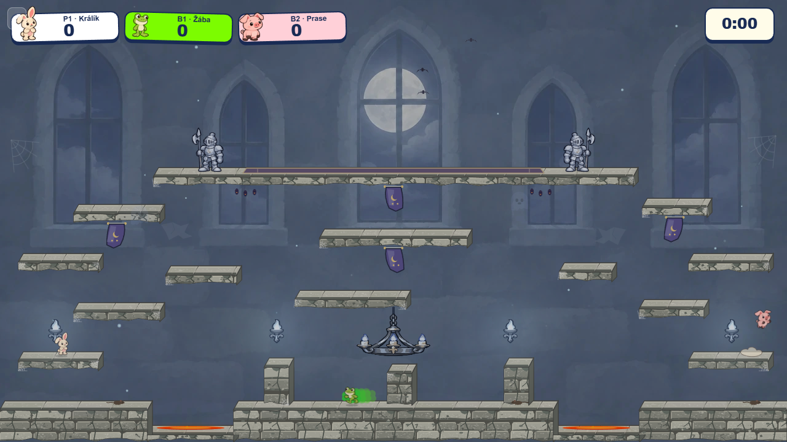 | — | The room after removing the portraits. |
| Subdued live baseline |  | [Second worker mode](faded-live-simWorker-off.png) | Updated guards, sconces, chandelier and existing banners without new wall props. |
| A · Shield and spears | 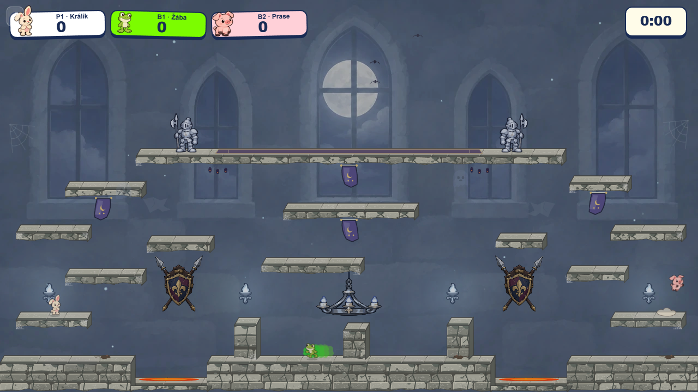 | [Detail](detail-a-shield-spears.png) | Strong heraldic silhouettes; the spear tips may look hazardous. |
| B · Swords and mace rack |  | [Detail](detail-b-sword-mace-rack.png) | An armory identity with every weapon visibly fixed to a wall rack. Darker and busier at game size. |
| C · Trophy shelf | 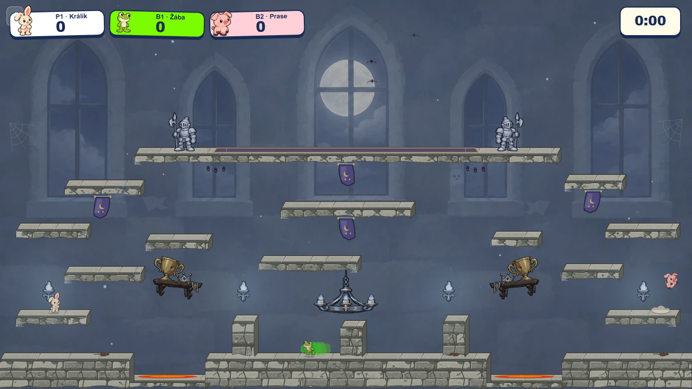 | [Detail](detail-c-trophy-shelf.png) | A funny trophy and broken crown, but the horizontal shelf risks suggesting a usable ledge. |
| D · Tournament pennant | 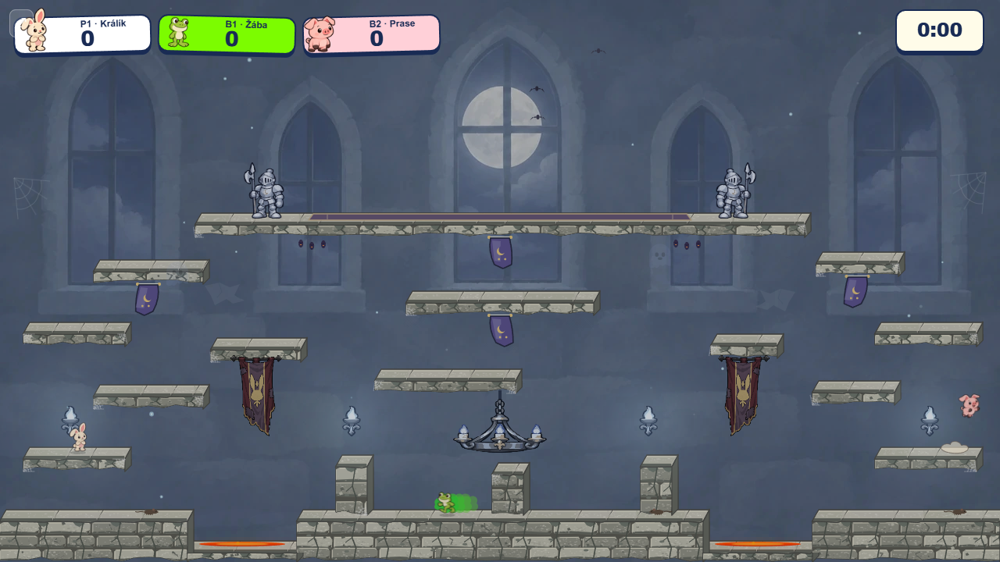 | [Detail](detail-d-tournament-pennant.png) | Soft cloth and a rabbit emblem; may repeat the four existing platform banners. |
| E · Asymmetric armory | 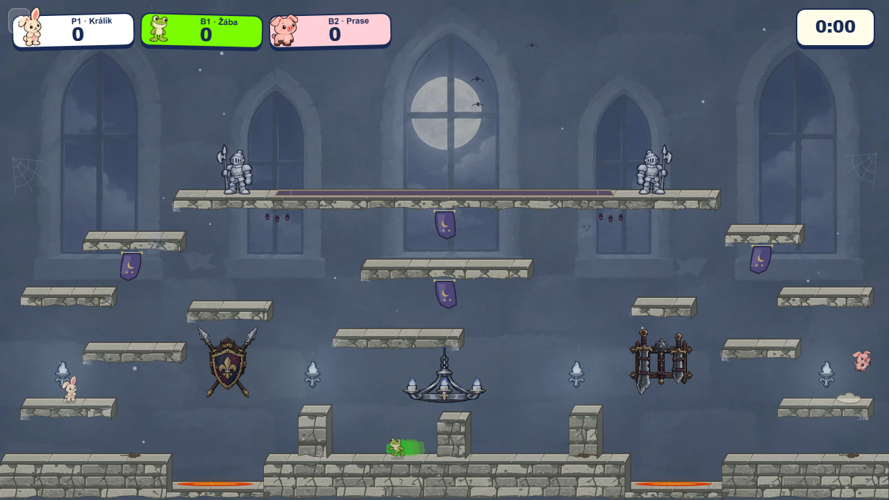 | [Detail](detail-e-asymmetric-armory.png) | The two weapon displays together without mirrored repetition. |
| F · Trophy plaque | 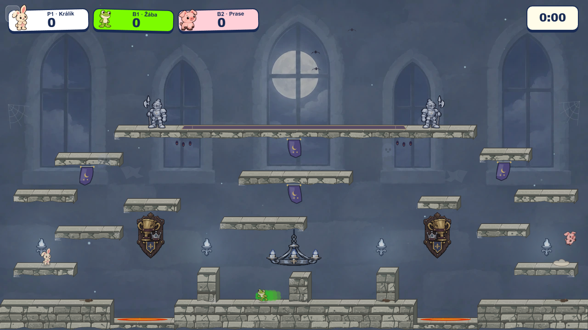 | [Detail](detail-f-trophy-plaque.png) | Cup and crown strapped to a vertical wooden plaque; no ledge silhouette. |
| G · Stone trophy niche | 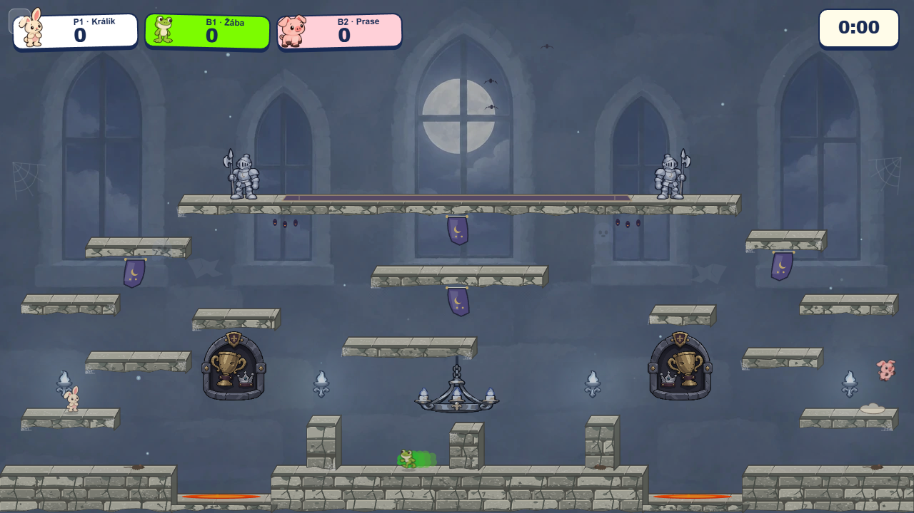 | [Detail](detail-g-trophy-niche.png) | Flatter stone treatment tied to Castle masonry; quieter at game size. |
| H · Armory and pennant | 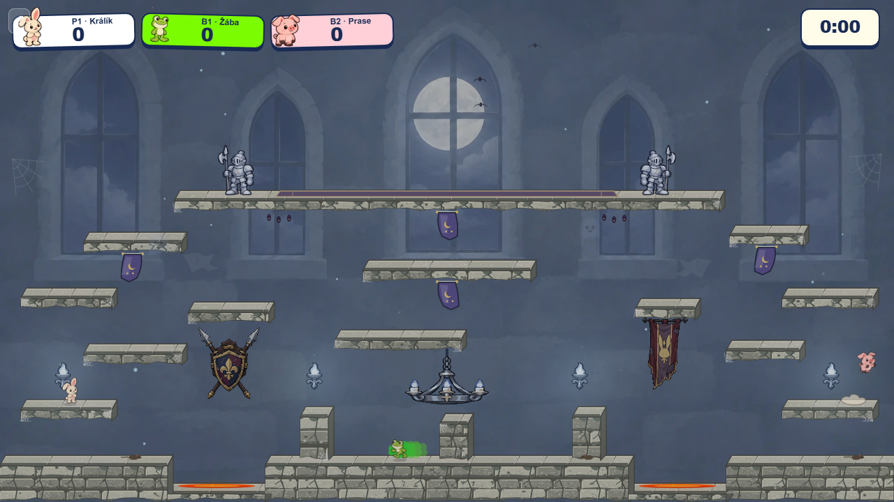 | [Detail](detail-h-armory-pennant.png) | Combines two treatments that read well in the game scene. |
| I · Plaque and rack |  | [Detail](detail-i-plaque-armory.png) | Checks the revised trophy alongside an accepted armory display. |
| J · Simple shields | 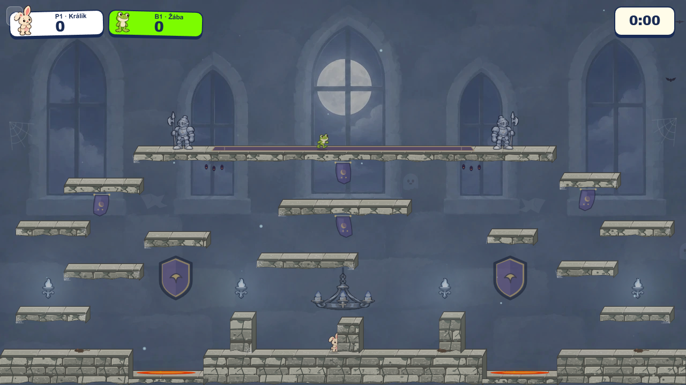 | [Detail](detail-j-simple-shields.png) | One silhouette, two color planes, one emblem. No weapons or fittings. |
| K · Simple sword stands | 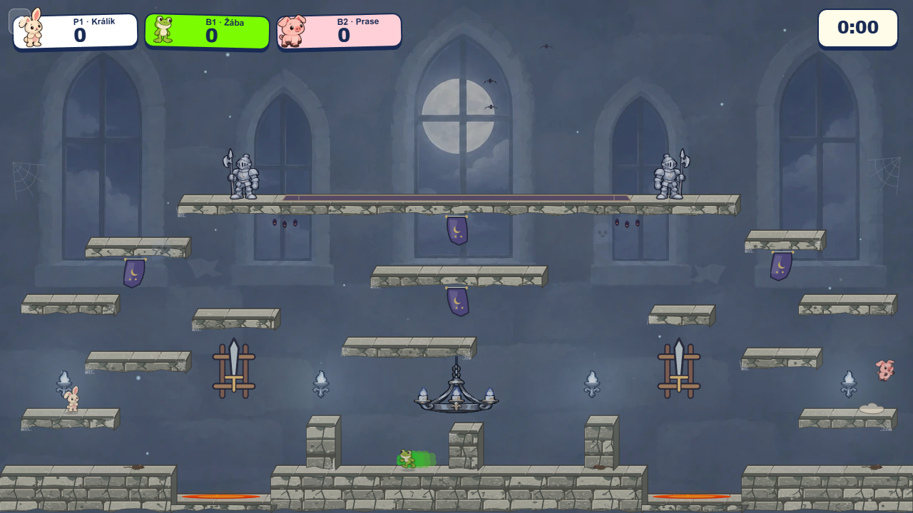 | [Detail](detail-k-simple-stands.png) | One sword on an open wooden frame; removes the busy weapon assortment. |
| L · Simple trophies | 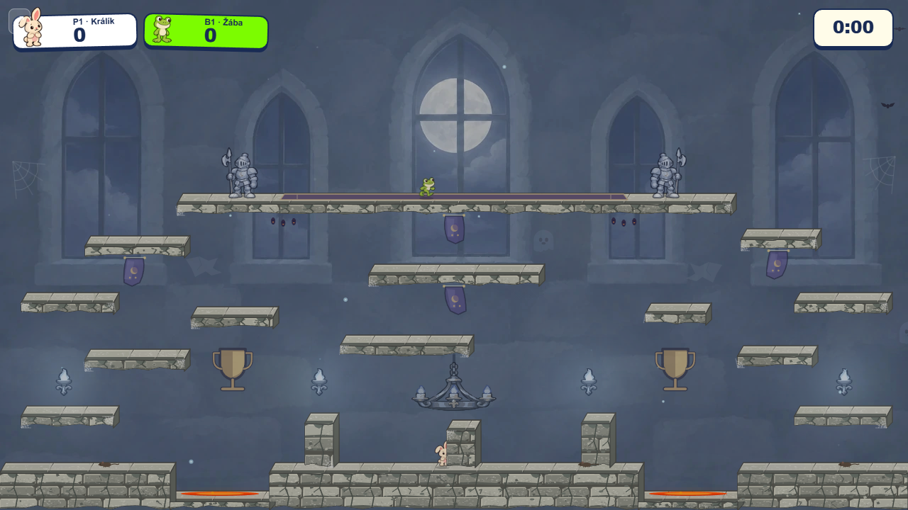 | [Detail](detail-l-simple-trophies.png) | A plain cup silhouette without a plaque, crown, shelf, or small ornament. |
| M · Shield and pennant | 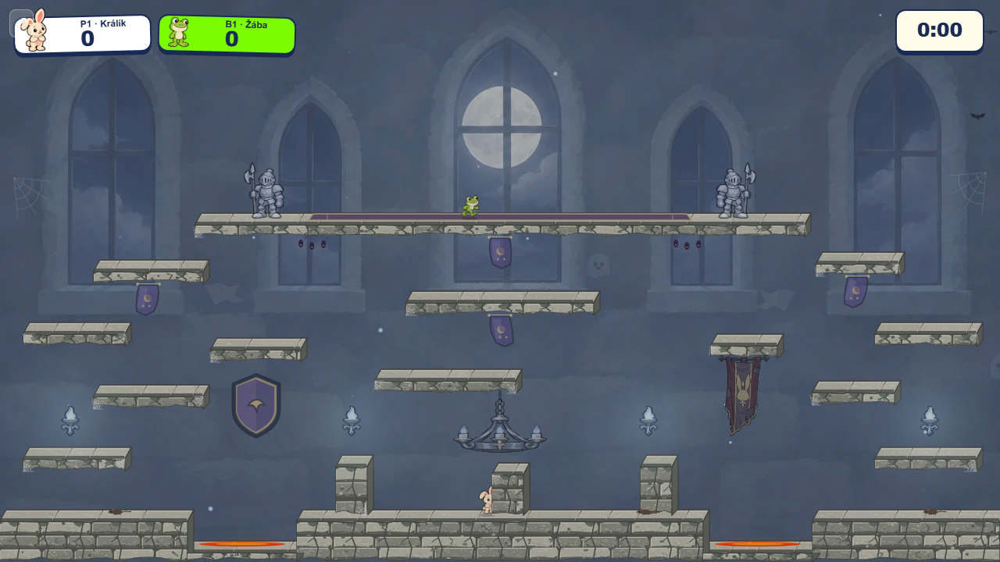 | [Detail](detail-m-shield-pennant.png) | Tests the reduced shield beside the previously liked cloth treatment. |
| N · Stand and trophy | 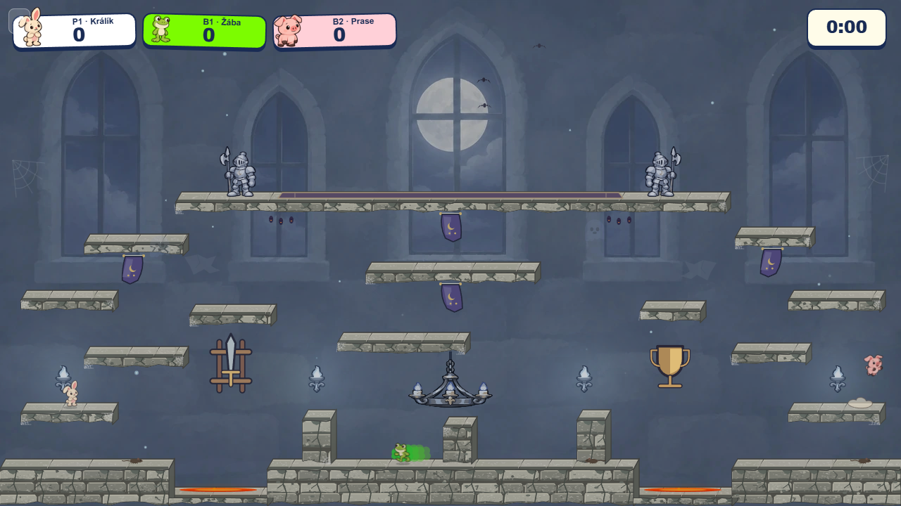 | [Detail](detail-n-stand-trophy.png) | Two different objects at the same reduced detail level. |
| O · Crossed swords and pennant | 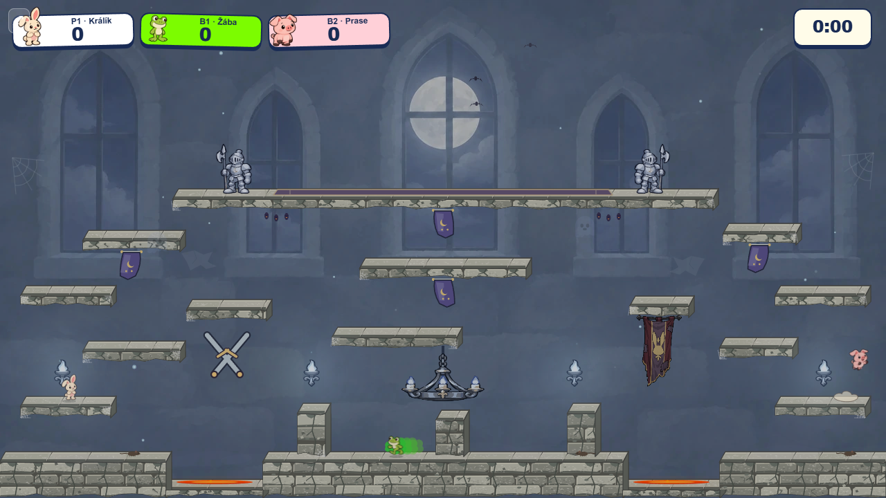 | [Detail](detail-o-swords-pennant.png) | The fewest shapes that still signal an armory, paired with cloth. |

The [shield and spears](sources/shield-spears.png), [sword and mace rack](sources/sword-mace-rack.png), [trophy shelf](sources/trophy-shelf.png), and [tournament pennant](sources/tournament-pennant.png) are isolated transparent concept sources. They were generated with the same art brief: bold dark cartoon contours, chunky shapes, broad cel shading, muted plum/navy/gold/silver, and visible wall attachments. The [render script](render.mjs) places and grades them on one captured game frame; it is reproducible with Playwright and installed Edge/Chromium. Their presentation size and grade are part of this study, not final runtime assets.

## Style revision after review

The armor displays and pennant felt compatible with the arena; the trophy shelf looked like it came from a different illustration. The original cup had a painterly material treatment and rested on a long, visually playable wooden ledge. [F's plaque source](sources/trophy-plaque.png) and [G's niche source](sources/trophy-niche.png) were edited from the original cup-and-crown reference, with the accepted rack and pennant supplied as explicit style references. The prompts required dark cartoon contours, two or three broad value planes, muted gold and silver, vertical wall attachment, and no projecting shelf. Both are still **concepts**, not game assets.

F is clearer than G at match size, but the trophy theme remains optional. H compares the already compatible shield and pennant without repeating either across both bays; I tests whether F can share a scene with the rack. My current preference is **H** for the room's balance, with **F** as the best trophy treatment if a trophy is wanted. Before implementing any weapon display, soften the spear tips so they cannot be confused with damaging thorns. Selection still needs a moving-character check in both simulation modes.

## Simpler silhouette pass

After seeing F–I in the scene, the plaque and rack still had too much material rendering and interior detail. J–O are a deliberately much simpler comparison. Their [editable SVG sources](sources/simple-shield.svg) use large silhouettes, a dark contour, at most two broad fill planes, and one recognizable motif. The render script places them at the same wall-bay positions and leaves the previously liked pennant intact. The full scene matters here: a detailed prop can look attractive in a crop but compete with the players and platforms when seen at game size.

**J and M are the strongest simplified options** because the shield stays readable and shares the pennants' purple and gold. The sword stand is more literal but weaker as decoration; the bare trophy is readable but currently looks like an emblem rather than a physical wall display. These are exploratory mockups, not selected runtime art. Earlier A–I remain in the table for comparison, not as current recommendations.

## Background contrast pass

The simplified props initially looked like foreground objects because their ink and colors were as strong as the playable stone and characters. J–O composite at 58% opacity over a production capture from that stage. The existing Castle guard art moved from 87% to 62% opacity, the sconce art from 80% to 65%, the chandelier to 58%, and the hanging banners to 62%; their interior shading was attenuated too. The [default worker](faded-live-default.png) and [`simWorker=off`](faded-live-simWorker-off.png) captures preserve that rejected translucent state. Keep the glassy moon backdrop, landing edges, players, spring and thorns at their existing contrast: those surfaces and objects carry gameplay information. The [current playable layout](../wall-props-live/README.md) instead uses solid muted colors and full-alpha drawing.
