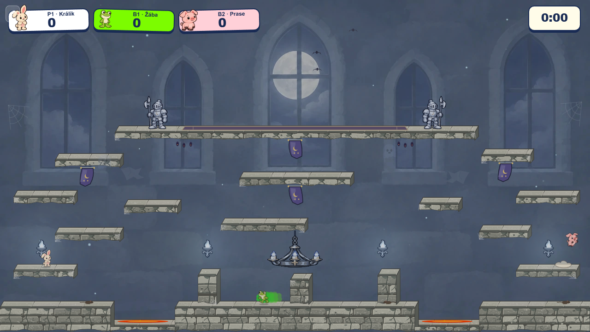
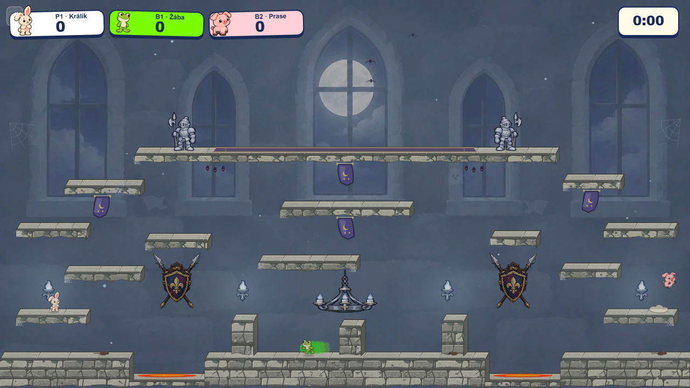
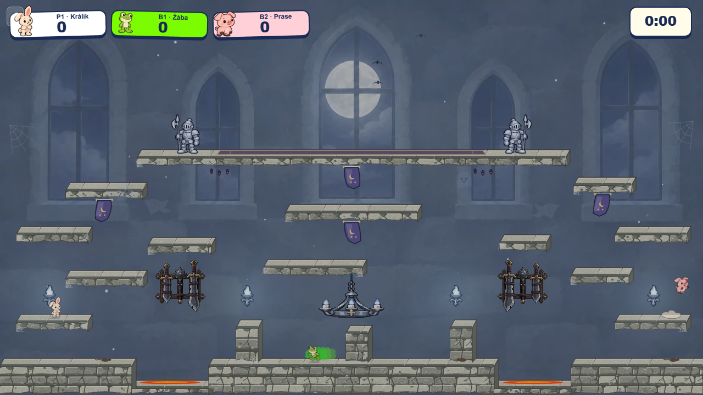
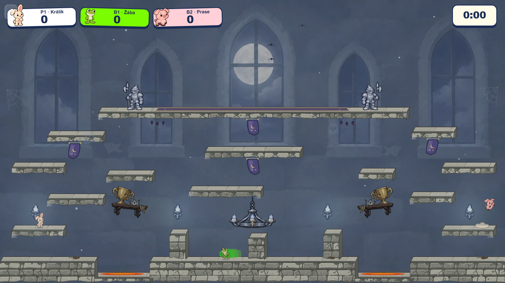
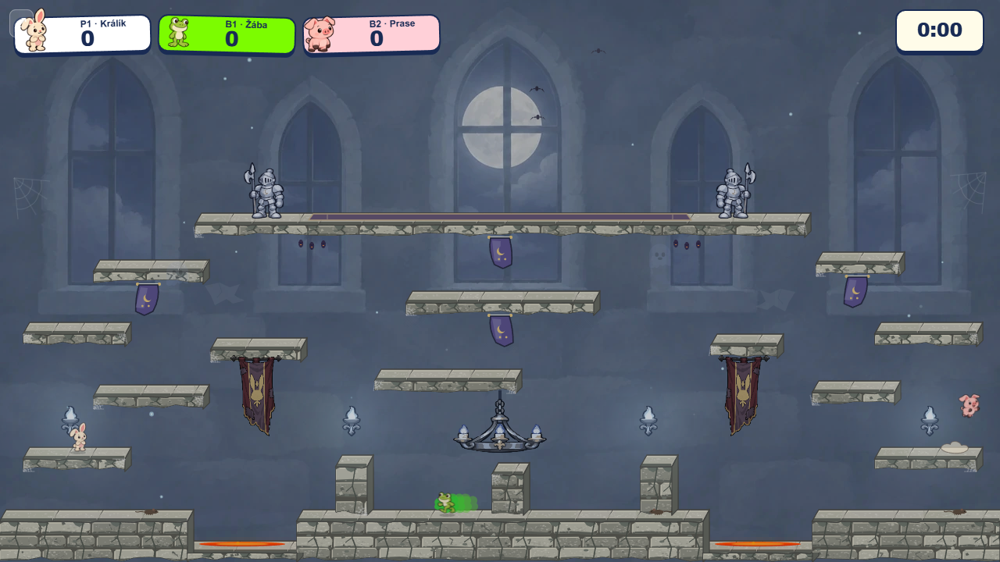

# Castle wall prop study

The royal portraits were rejected and removed from the Castle draw and preload paths. This study tests four alternatives in the two empty lower wall bays. All images use the same 1280 × 720 production-renderer screenshot after the countdown, with the same characters, lighting, platforms and camera. The new props are **mockup overlays**, not implemented game art. Windows, collision and existing banners are unchanged.

| Direction | Full scene | Native-size detail | What it tests |
| --- | --- | --- | --- |
| Empty baseline |  | — | The room after removing the portraits. |
| A · Shield and spears |  | [Detail](detail-a-shield-spears.png) | Strong heraldic silhouettes; the spear tips may look hazardous. |
| B · Swords and mace rack |  | [Detail](detail-b-sword-mace-rack.png) | An armory identity with every weapon visibly fixed to a wall rack. Darker and busier at game size. |
| C · Trophy shelf |  | [Detail](detail-c-trophy-shelf.png) | A funny trophy and broken crown, but the horizontal shelf risks suggesting a usable ledge. |
| D · Tournament pennant |  | [Detail](detail-d-tournament-pennant.png) | Soft cloth and a rabbit emblem; may repeat the four existing platform banners. |
| E · Asymmetric armory |  | [Detail](detail-e-asymmetric-armory.png) | The two weapon displays together without mirrored repetition. |

The [shield and spears](sources/shield-spears.png), [sword and mace rack](sources/sword-mace-rack.png), [trophy shelf](sources/trophy-shelf.png), and [tournament pennant](sources/tournament-pennant.png) are isolated transparent concept sources. They were generated with the same art brief: bold dark cartoon contours, chunky shapes, broad cel shading, muted plum/navy/gold/silver, and visible wall attachments. The [render script](render.mjs) places and grades them on one captured game frame; it is reproducible with Playwright and installed Edge/Chromium. Their presentation size and grade are part of this study, not final runtime assets.

My strongest direction is **E**, because the bays gain different silhouettes while the platforms remain visually dominant. Before implementation, soften the spear tips to distinguish them from Castle's damaging thorns and simplify the rack's interior lines for readability. C and D are useful comparisons but have the clearest gameplay and repetition risks. Selection should be checked with moving characters and both simulation modes before converting any concept to scalable game art.
