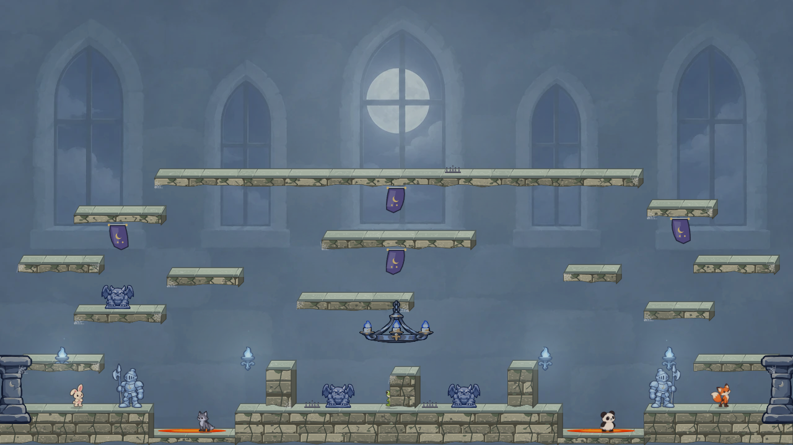
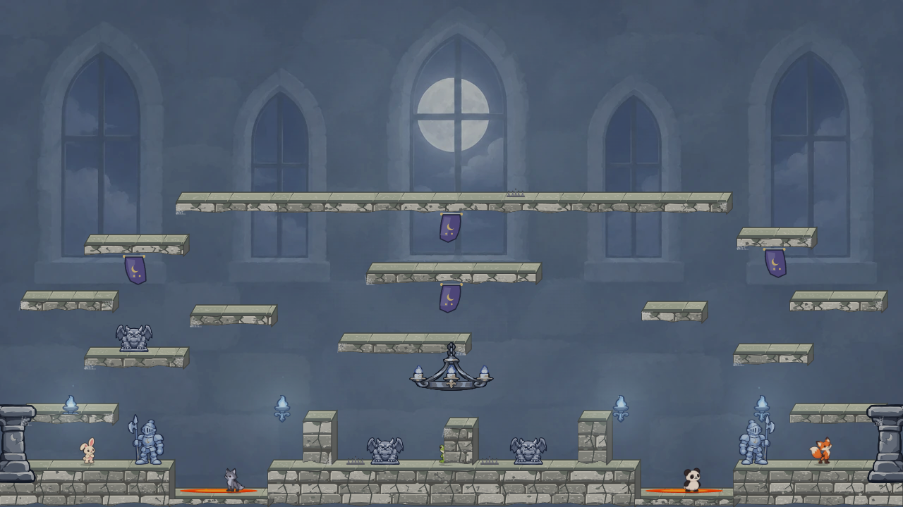
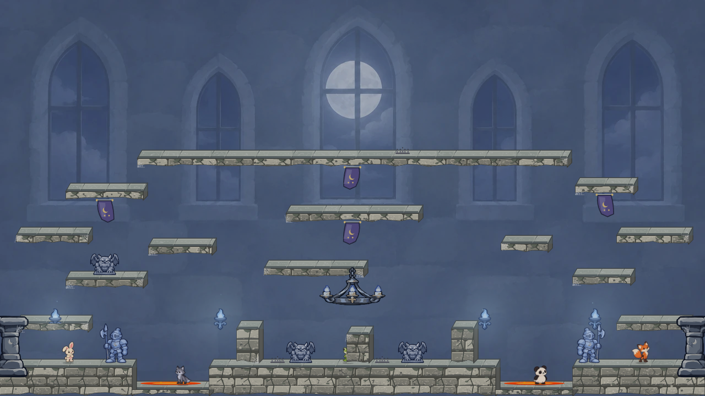
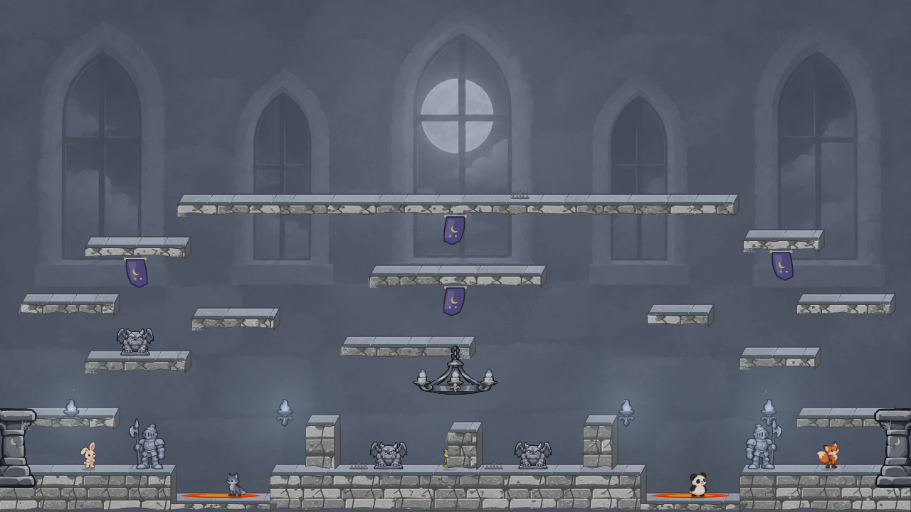
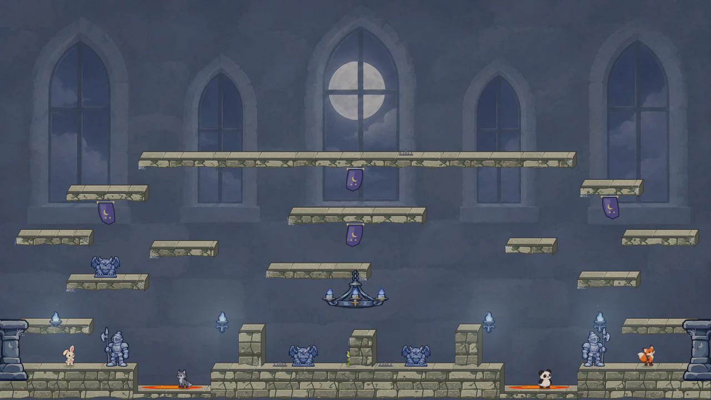
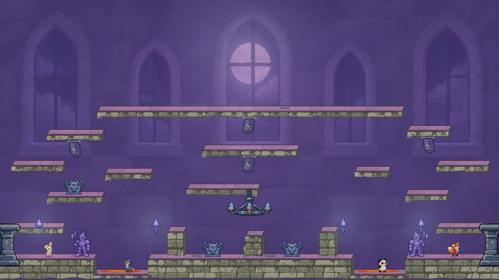
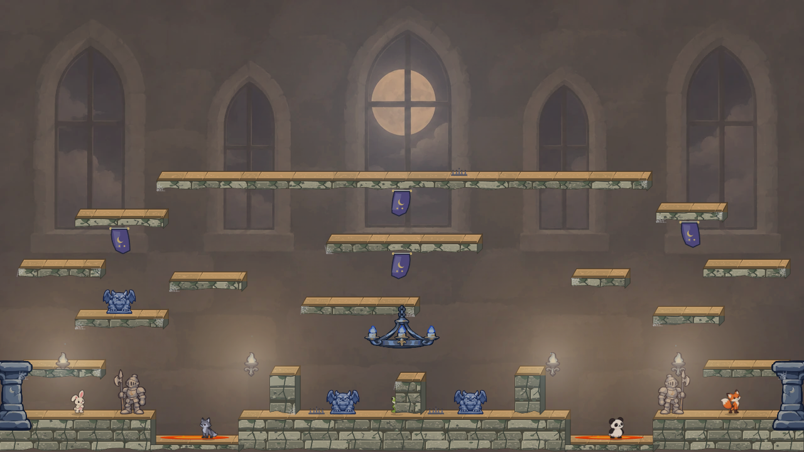

# Castle atmosphere study

## Silver Moon follow-up

The first Silver Moon lifted only the background and made the room too pale. Its platform faces, Guardian, chandelier, and other foreground props kept the old blue-gray treatment, so they appeared pasted onto a brighter room. The follow-up below reduces the lift and grades those Castle draw calls as well. Character sprites retain their original colors for gameplay contrast. All captures use the same scene and 28 × 12 thorn samples. **Balanced Silver is my preference**; Deep Silver keeps more night depth, while Pewter is an intentionally less blue option.

| Direction | Matched full scene | Read at game size |
| --- | --- | --- |
| Original Silver Moon |  | Too pale; foreground material remains blue. |
| Balanced Silver |  | Moderate lift, silvered Guardian and platform faces, clear player silhouettes. |
| Deep Silver |  | Deeper blue shadows and slightly stronger moon focus. |
| Pewter Moon |  | Desaturated stone and props; coherent, but loses some Castle color character. |

The mockup uses a static background pixel remap and filtered draw calls for platform faces, Castle props, Guardian and thorns. **Those are study tools, not the intended runtime implementation.** A selected grade should be baked into the painted plate and expressed in the Canvas art palettes or pre-rendered assets, so there is no per-frame screen filter or pixel loop. Reactive banners, blue flames, and moving effects still need a live motion review before shipping a selection.

## Initial palette exploration

Castle is a fixed moonlit interior, with a painted window wall, pale limestone platforms, blue sconces, and the approved Guardian spring. This pass tests **three distinct color and light directions** in a matched 1280 × 720 renderer scene. Character sprites and foreground props retain their colors so their readability can be judged against each room treatment. The prior thorn samples are only comparison fixtures; no thorn art, collision, or placement changes are proposed here.

| Direction | Scene | Effect and tradeoff |
| --- | --- | --- |
| Current |  | Restrained blue-gray, but the back wall, platforms, and guardian share a narrow range. |
| A · Silver Moon |  | Pale blue wall and a broader moon glow; cleanest separation for dark props, though the room loses some depth. |
| B · Violet Vigil |  | Deliberately theatrical violet shadows and lavender moon; distinct mood, but the purple platform tops compete with banners. |
| C · Ember Hall |  | Warm stone and sconce pools against cool prop silhouettes; strong color contrast, but the existing blue flames would need a coordinated color change. |

The original Silver Moon motivated the follow-up above. Ember Hall is the bolder option if Castle should feel warmer; Violet Vigil shows the upper limit of saturation rather than a recommended production grade. The [gallery](index.html) presents all scenes at matching size.

The [grade study source](grades.ts) remaps static background pixels and adds broad radial light pools. This is a fast way to explore palettes **in the mockup**, not a proposed runtime pixel loop. If one direction is approved, implement it by changing the baked painted plate and static Canvas palette, and coordinate emitter colors separately. Keep player sprites, thorn silhouettes, collision, and background/foreground draw order intact. Then verify the production scene and moving effects in both worker modes.
