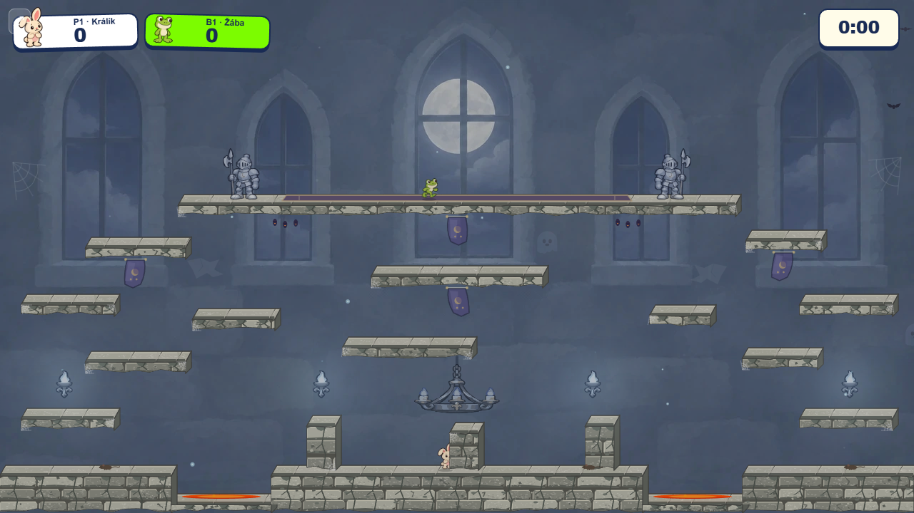
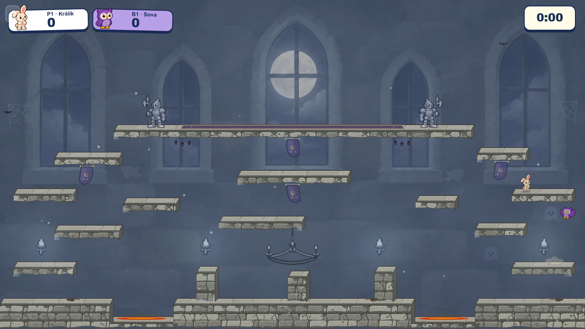
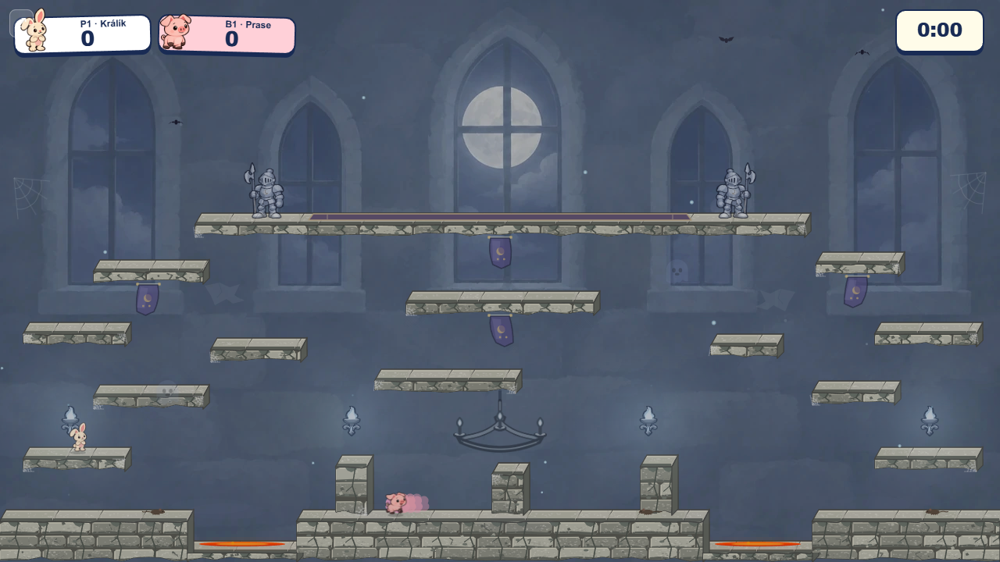

# Simplified Castle chandelier

The first traced chandelier was ornate at source size but became a cluster of tiny metal parts and five flames at its 120 × 69 game size. The revised fixture keeps one broad iron arc, three clear flames, a plain central hanger, and no fleur-de-lis or repeated fittings. Its subdued 58% runtime opacity is unchanged, so it stays behind players and platform edges in the scene's visual hierarchy.

| Previous live scene | Simplified live scene | Second worker mode |
| --- | --- | --- |
|  |  |  |

The editable [new SVG](../svg/chandelier.svg) replaces the runtime source; the [original trace](../svg/chandelier-traced-original.svg) is retained for comparison. Run `rasterize.mjs chandelier`, then `bakeBalancedSilver.mjs castle-chandelier-cartoon`, with `CASTLE_PROPS_BROWSER` set to Edge or Chromium to rebuild the two transparent WebPs. The 246 × 155 raster is approximately twice the displayed size. The updated Balanced Silver WebP is 8,480 bytes, smaller than the prior 12,046-byte version. The chandelier's draw bounds and chain attachment are unchanged. Both screenshots above come from the production preview after countdown, with no browser errors.
