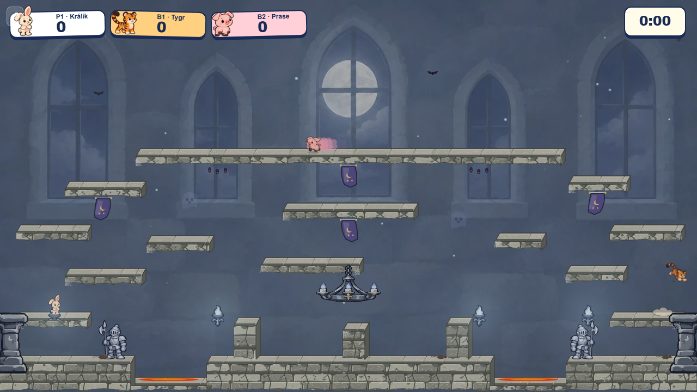
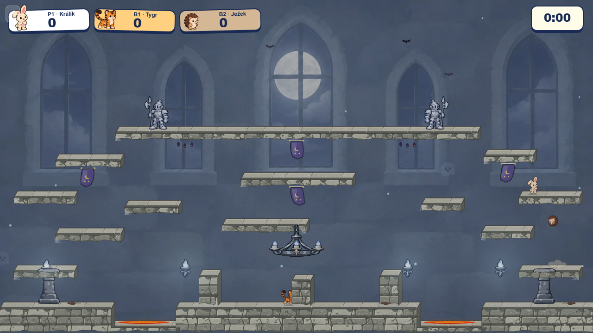
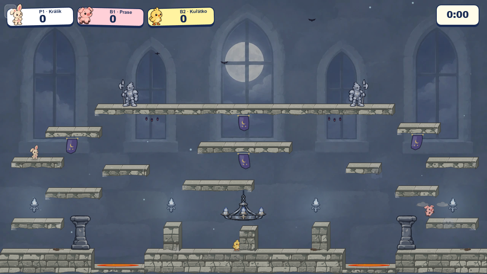

# Castle prop layout: clear wall and floor bays

The long upper landing looked empty while the two armor guards crowded the ground. The edge columns were half-clipped and did not appear attached to the room. Moving the guards to the gallery improved that balance, but the first attempt to put the columns directly under the side ledges made them overlap the platform art. Its low sconces also crossed the ledges and the left column. The revised pass keeps the gallery guards and separates every floor and wall prop from the nearby platforms. Arena geometry, collision, and spawns are unchanged.

| Previous Balanced Silver layout | First gallery pass | Revised clear bays |
| --- | --- | --- |
|  |  |  |

The guards stand near the ends of the 780 px upper gallery. Its center remains clear for the player spawn at x=640 and for the moon/window silhouette. The columns now stand in open floor bays at x=184 and x=1042; their 54 × 94 art reaches the ground without touching the side ledges. Four sconces occupy x=90, 450, 830, and 1190, raised into open wall bays and spaced across the width. Their light emitters and motes follow the new locations. The chandelier hangs 25 px lower, with its chain extended to the middle shelf. Columns remain behind players rather than creating foreground hiding. Banners, Guardian springs, and all platform positions stay in place.

The [default worker](clear-bays-default.png) and [`simWorker=off`](clear-bays-simWorker-off.png) captures come from the playable production preview after countdown. Both modes loaded the Castle art and completed a Meadow-to-Castle switch without page errors. Assess the motion of characters crossing the gallery and floor bays before merging the PR.
