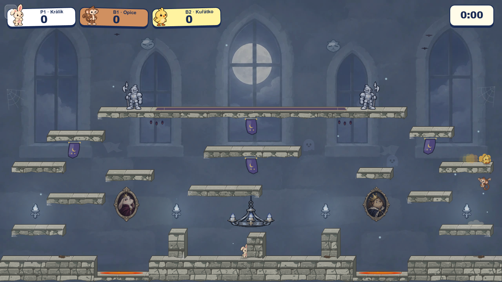
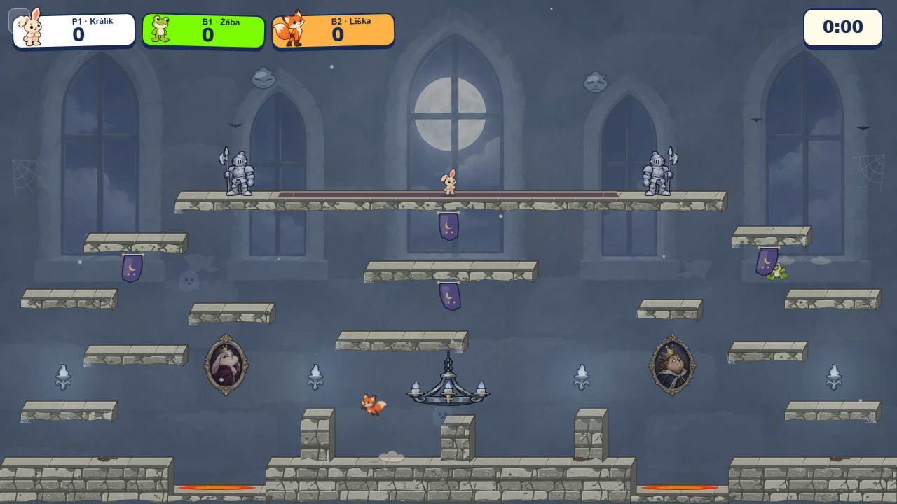

# Castle royal gallery: replacing the false platforms

The freestanding columns in the previous layout looked like playable ledges even though they had no collision. This pass removes them in both the illustrated and fallback paths. It fills the room with details that read as part of the existing wall: two recessed royal portraits, small gargoyle keystone faces, sparse cobwebs and worn plaster. The long upper platform gets a runner flush with its top and shallow relief on its front face. Existing windows, platform geometry, collision, guards, sconces, chandelier, banners, and spring positions are unchanged.

| Previous clear-bays layout | Royal gallery, default worker | Royal gallery, `simWorker=off` |
| --- | --- | --- |
|  |  |  |

The rabbit duchess and hedgehog king were generated as painted storybook references, alpha-cropped and graded into transparent 276-pixel-high WebP assets with [preparePortraits.mjs](preparePortraits.mjs). Their [source PNGs](duchess-source.png) and [king source](king-source.png) remain here for art review. The game displays them at 91 pixels high and preloads them with Castle's other fixed art. The runtime pair totals 44,262 bytes; the removed column no longer preloads. The small wall, web, runner and frieze shapes are Canvas paths drawn in the arena's cached background pass, not every frame.

The art generation prompt specified a transparent isolated oval carved frame, a mildly smug lop-eared rabbit duchess in plum, and a slightly clueless hedgehog king in midnight blue. It asked for thick dark storybook contours, broad paint and stone shading, muted silver-gold, no text, and no scene background. The source was then cropped by nontransparent pixels and graded at 72% saturation, 90% brightness, 104% contrast to sit behind the characters.

Production preview checks loaded the six fetched Castle/Guardian assets plus the inline sconce, rendered direct Castle entry and Meadow-to-Castle switching without page errors in both simulation modes. The build, focused backdrop asset tests, and changed-file lint pass. The live captures are after the countdown at 1280 × 720; they establish layout and loading, not every moving-player overlap.
