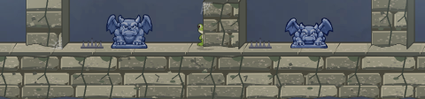
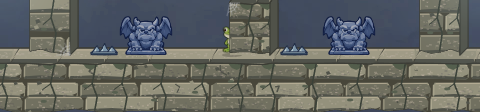
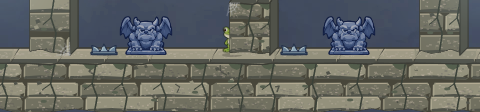

# Castle thorn study

The Guardian spring is now in Castle. These three thorn proposals keep the existing **28 × 12 collision box** and use the same palette of moonlit blue steel, dark ink, and broad highlights. Each scene is captured from the real 1280 × 720 renderer with the approved Castle background, platforms, props, characters, and Guardian. The two ground samples were moved clear of the foreground columns for this comparison; no production thorn placement or gameplay changed.

| Direction | Full scene | 1:1 action-lane crop | Read at game size |
| --- | --- | --- | --- |
| Current | [Open](actionable-current.png) |  | Five thin points blend into the stone. |
| A · Forged Fangs | [Open](thorn-forged-fangs.png) |  | Three unequal, curved teeth make a clear danger silhouette. |
| B · Crescent Iron | [Open](thorn-crescent.png) |  | Swept outer blades echo the moon, but the low sides soften the hazard cue. |
| C · Split Crown | [Open](thorn-split-crown.png) |  | Broken portcullis profile reads as Castle architecture; its shallow teeth are less immediately dangerous. |

The [Canvas variant source](variants.ts) draws at 28 × 12 logical pixels and scales with the existing thorn renderer. It avoids texture finer than a one-pixel highlight. **A · Forged Fangs is my recommendation** because its three large points remain distinct beside the detailed Guardian and pale limestone, without resembling the spring. The other two are retained for review. None of these drawings is wired into production yet.

[Open the side-by-side gallery](index.html) for the full scenes and enlarged action-lane crops.
