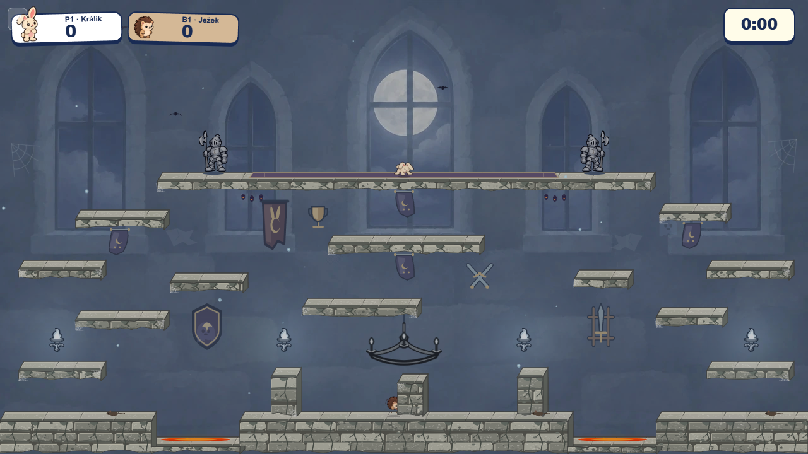
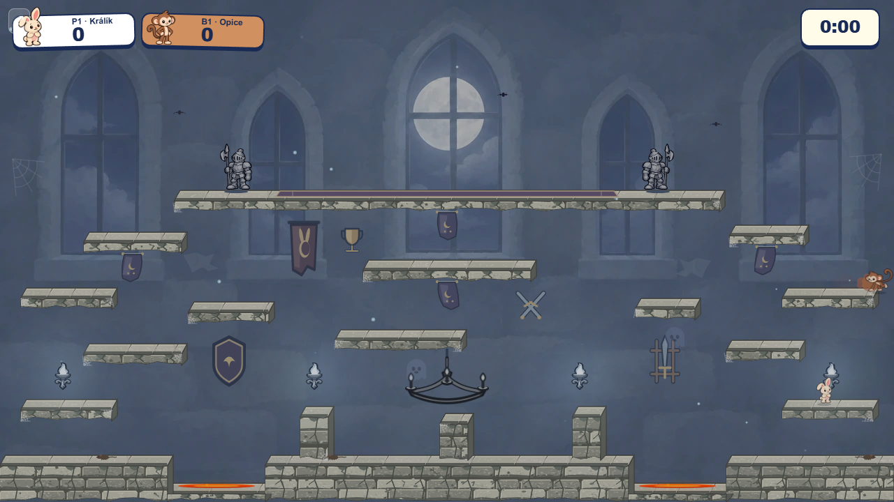

# Castle wall decorations in play

The simplified [wall-prop study](../armory-study/README.md) is now represented in the playable Castle. One each of the shield, single-sword stand, trophy, crossed swords, and tournament pennant occupies a separate wall bay. They use opaque, muted Canvas colors on the cached background layer; no extra image downloads or foreground draw calls were added. The original, more detailed concept PNGs remain study references.

The first playable layout put armor in wall mounts below the gallery. That looked disconnected from the original room, so the suits returned to their original positions on the upper gallery. They are slightly smaller and sit on its rear visual plane, with their feet eight pixels above the player's front contact line. A [posed overlap check](armor-crossing.png) puts Bunny at the old problem spot in the real renderer. The fallback Canvas suits use the same rear-plane bounds. Platform and spawn geometry, collision, Guardian spring, and thorns are unchanged.

| Previous translucent pass | Current opaque pass | `simWorker=off` |
| --- | --- | --- |
|  |  |  |

The first fade reduced alpha across the armor, wall props, chandelier and banners; the painted wall showed through their bodies. The current pass uses solid fills, darker and less saturated colors, and full-alpha image drawing. The [Canvas source](../../../../src/engine/arenas/packs/castleWallProps.ts) keeps every item editable and its bounds explicit. A layout test checks a five-pixel gap around playable platform rectangles for each wall item and the armor's setback from the player contact line. The small trophy stays high on the wall so it cannot resemble a collectible resting on a platform.
