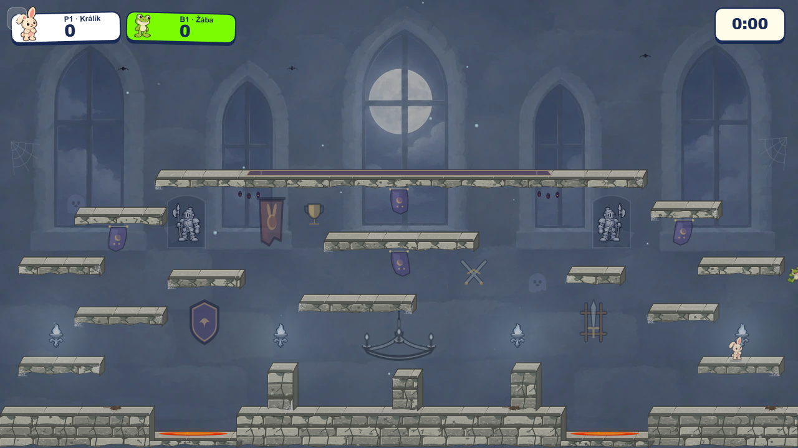
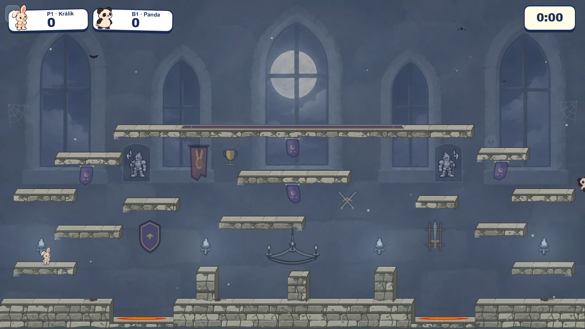

# Castle wall decorations in play

The simplified [wall-prop study](../armory-study/README.md) is now represented in the playable Castle. One each of the shield, single-sword stand, trophy, crossed swords, and tournament pennant occupies a separate wall bay. They use a small set of Canvas shapes at 54% opacity on the cached background layer; no extra image downloads or foreground draw calls were added. The original, more detailed concept PNGs remain study references.

The two armor suits no longer stand on the upper gallery's playable top. They sit in shallow wall mounts below that platform and between the windows, with their feet above open wall. Players can traverse the gallery without crossing the suit silhouettes. The fallback Canvas suits use the same mounts. Platform and spawn geometry, collision, Guardian spring, and thorns are unchanged.

| Default simulation worker | `simWorker=off` |
| --- | --- |
|  |  |

The [Canvas source](../../../../src/engine/arenas/packs/castleWallProps.ts) keeps every item editable and its bounds explicit. A layout test checks a five-pixel gap around playable platform rectangles for each item and both armor mounts. Review the full 1280 × 720 scene rather than isolated artwork: the small trophy sits high on the wall so it cannot resemble a collectible resting on a platform, while the sword stand and shield occupy the larger lower wall bays.
